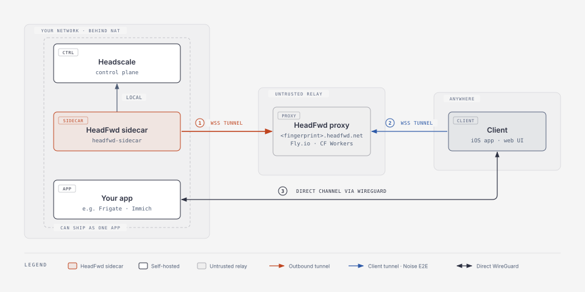

# HeadFwd

A design pattern for remote access to self-hosted apps at home.

## What is this?

HeadFwd lets you access your self-hosted apps from anywhere using [Headscale](https://github.com/juanfont/headscale) (self-hosted Tailscale), even if your server is behind NAT/firewall.

**Problem:** Setting up remote access for a self-hosted app sucks. Typically, you:
1. Set up port forwarding so you can get to your app
2. Set up DDNS so you can always reach it
3. Set up an auth layer so no bad actors get in / see your data

**Solution:** A zero-knowledge reverse tunnel. It's like ngrok, but the proxy can't see your keys or data

## Architecture

<picture>
  <source media="(prefers-color-scheme: dark)" srcset="docs/images/architecture-default-dark.svg">
  
</picture>

1. The sidecar dials out and keeps a persistent WSS tunnel open to the proxy, so no inbound ports are needed.
2. Clients open a websocket tunnel to `https://<fingerprint>.headfwd.net`, and the proxy forwards it into the sidecar's tunnel. This carries Tailscale's TS2021 control protocol messages, which are Noise-encrypted end to end, so only your Headscale instance at home can read it. The client app was given the Headscale's `<fingerprint>` when it first scanned a QR code to access your self-hosted app.
3. Devices then talk directly over a secure direct WireGuard channel.

You now have the best of both worlds; a secure, fully local control plane AND remote access.

The proxy is a stateless relay and only routes to your Headscale based on your public fingerprint (the subdomain in `<fingerprint>.headfwd.net`). It never sees your keys or plaintext. Even if a rogue relay forwards to the wrong Headscale instance, your clients will reject it since they pin the fingerprint.

> Personal note: I've been using this in my apps for ~6 months now, and it's been working super reliably. Since hosting a control plane proxy carries no data, and costs virtually nothing, I intend to keep `headfwd.net` running as a free public proxy for anyone to use in their apps, indefinitely. I've got experience running systems at scale, and I can fight the abuse it receives. That said, feel free to run your own proxy or only use me as backup.

## Example: Frigate cameras

Pretend you've set up cameras at home with [Frigate](https://frigate.video/), and you want to check them from your phone while you're out. What you don't want:

* **Footage passing through a middle party.** A cloud camera service, or a relay that terminates TLS (e.g. Cloudflare Tunnels), can see your video. It also adds latency and has to carry the bandwidth.
* **Port forwarding.** Every open port is reachable by the whole internet, and a router or dynamic IP change quietly breaks it.
* **A public login page** in front of Frigate, or a reverse proxy with external auth. That puts an attack surface on the internet, and it has to be patched and kept working forever.

With HeadFwd, Headscale and the sidecar run on the same box as Frigate, either alongside it or built into a single app. Nothing listens on a public port: the sidecar dials out to the proxy. Your phone scans a QR code to join your own tailnet via that tunnel, and the proxy relays only control traffic which it cannot decrypt. Video then travels over WireGuard, encrypted end to end between your phone and Frigate, so no middle party can ever see your footage.

## Components

* **`headfwd-sidecar/`** - Go sidecar that runs with Headscale: opens the tunnel, auto-registers, and serves an optional admin portal (embedded React UI for user management, device onboarding, connectivity proof)
* **`headfwd-proxy/`** - Go proxy, deployed on Fly.io (full TS2021 control-plane support). Note: A Cloudflare Workers version is parked on the [`cloudflare-proxy`](https://github.com/pastudan/headfwd/tree/cloudflare-proxy) branch until Workers can proxy TS2021's custom HTTP Upgrade.
* **`ios/`** - An example SwiftUI iOS app that connects via tsnet (embedded `libtailscale`), with QR onboarding and Noise-key verification/pinning
* **`docs/REGISTRATION.md`** - Sidecar↔proxy registration protocol (X25519 ECDH + HMAC-SHA256 challenge-response)
* **`docs/ios-key-verification.md`** - iOS key verification & pinning (preauth-key theft protection)

## Security

HeadFwd is designed on the principle that **the proxy is untrusted**. All security-critical values are derived and verified locally; the proxy is treated as a dumb (and potentially rogue) relay.

### Sidecar ↔ Proxy Registration

Before a sidecar is granted a tunnel, it must prove possession of Headscale's Noise private key via an X25519 ECDH + HMAC-SHA256 challenge-response. The proxy cannot impersonate a legitimate sidecar, and a sidecar cannot register without the private key.

See **[`docs/REGISTRATION.md`](docs/REGISTRATION.md)** for the full protocol.

### iOS Key Verification & Pinning

Before the iOS app hands control to tsnet, it independently verifies that the Headscale Noise public key served by the control URL hashes to the fingerprint embedded in the QR code's server URL. A patched libtailscale then reads the verified key from disk so tsnet never fetches it from the proxy — closing a preauth-key theft attack that would otherwise be viable against a rogue proxy.

See **[`docs/ios-key-verification.md`](docs/ios-key-verification.md)** for the full threat model, attack chain, and implementation details.

## Quick Start

### 1. Deploy Proxy

You can use the public proxy at `headfwd.net`, or run your own on Fly.io:

```bash
cd headfwd-proxy
fly launch --no-deploy
fly secrets set PUBLIC_HOST=headfwd.net
fly deploy
```

### 2. Run Headscale + Sidecar

**Option A: Auto-Registration (Recommended)**
```bash
cd headfwd
docker compose up -d headscale

# Start sidecar with auto-registration
cd headfwd-sidecar
go build
./headfwd-sidecar \
  --register \
  --proxy "https://headfwd.net" \
  --headscale "http://localhost:8080" \
  --noise-key "/var/lib/headscale/noise_private.key"
```

**Option B: Manual Registration**
```bash
# Get Headscale's public key
PUBKEY=$(curl -s "http://localhost:8080/key?v=96" | jq -r .publicKey)

# Phase 1: Get challenge
RESPONSE=$(curl -s -X POST https://headfwd.net/api/register/init \
  -H "Content-Type: application/json" \
  -d "{\"publicKey\": \"$PUBKEY\"}")

# Phase 2: Compute HMAC proof from the X25519 ECDH shared secret
#          (sidecar Noise private key × proxy ephemeral public key) and verify.
# See docs/REGISTRATION.md for details

# Phase 3: Start sidecar with tunnel URL
./headfwd-sidecar --tunnel "wss://abc123.headfwd.net/tunnel?auth=secret"
```

> **Security Note**: The challenge-response protocol prevents unauthorized subdomain registration.  
> See [`docs/REGISTRATION.md`](docs/REGISTRATION.md) for architecture details.

### 3. Update Headscale Config

```yaml
# headscale/config/config.yaml
server_url: https://abc123.headfwd.net
```

### 4. Connect Clients

Clients scan a local QR code, connect to `https://abc123.headfwd.net` instead of direct IP.

## Cost

**To run your own proxy**, for yourself or for your users:
* [Fly.io](https://fly.io/): a single shared-cpu-1x instance comfortably runs the proxy; fits within the free/low-cost tier for personal use
* The proxy only relays encrypted control traffic — no per-GB data egress for the control plane

If you want to use my public `headfwd.net` relay:
* Nothing. It's free, and I plan to keep it online for good. And if it ever does go away, you're not locked in: your keys and fingerprint stay the same, so you point the sidecar at another proxy with `--proxy`, re-register, and have your devices scan a fresh QR code.

## Security Properties at a Glance

- **Challenge-Response Authentication** - Cryptographic proof of Headscale ownership
- **128-bit Fingerprints** - Collision-resistant subdomain identifiers (hex32)
- **Zero-Knowledge Proxy** - Sees only encrypted WireGuard/Noise traffic
- **X25519 ECDH + HMAC-SHA256** - The sidecar proves possession of Headscale's Noise private key via an ECDH shared secret with the proxy's ephemeral key; no new key material is introduced
- **iOS Key Pinning** - The app verifies the Noise key against the QR fingerprint and pins it so tsnet never trusts a proxy-supplied key
- **Time-Limited Challenges** - 5-minute nonce expiration prevents replay attacks
- **No Subdomain Enumeration** - Can't guess valid tunnels without private key
- **Never Trust the Proxy** - Fingerprints must be derived locally from Headscale's Noise public key and proxy-provided URLs must be verified against local derivation

For detailed security architecture, see [`docs/REGISTRATION.md`](docs/REGISTRATION.md).


## Documentation

- **[Registration Architecture](docs/REGISTRATION.md)** - Sidecar↔proxy challenge-response protocol (X25519 ECDH + HMAC-SHA256)
- **[iOS Key Verification](docs/ios-key-verification.md)** - Noise-key verification, pinning, and the preauth-key theft threat model
- **[Quick Start Guide](QUICKSTART.md)** - Step-by-step setup instructions
- **[Portal README](headfwd-sidecar/portal/README.md)** - Admin portal (built into sidecar), API docs, and development guide
- **[iOS App](ios/README.md)** - SwiftUI app build (XcodeGen + patched `libtailscale`)

## Next Steps

1. Point Claude at this repo and say "integrate it"

Or, if you prefer the human route:
1. Use the public `headfwd.net` proxy, or deploy your own on Fly.io
2. Run Headscale + sidecar; the sidecar auto-registers with challenge-response auth
3. Point Headscale's `server_url` at your `<fingerprint>.headfwd.net`
4. Build and connect the iOS app (or any Tailscale client) via QR onboarding

## License

MIT — see [`LICENSE`](LICENSE).

## Wanted: a second public proxy

I plan to keep `headfwd.net` online for good, but I could get hit by a bus. I'd like one more public proxy that the docs can recommend alongside mine, as a backup or co-primary, so no single operator (including me) is a point of failure.

The proxy is deliberately dumb: it holds no keys and sees no plaintext, so whoever runs it doesn't need anyone's trust. What it does need is someone willing to commit to keeping it online for the long haul.

If that's you, please [reach out to me](https://github.com/pastudan) and I'll add your proxy to the docs. Please don't spin up a public proxy without getting in touch first: the goal is two well-known, long-lived proxies, not many short-lived ones.

## References

- [Headscale](https://headscale.net/)
- [libtailscale](https://github.com/tailscale/libtailscale)
- [Fly.io](https://fly.io/)
