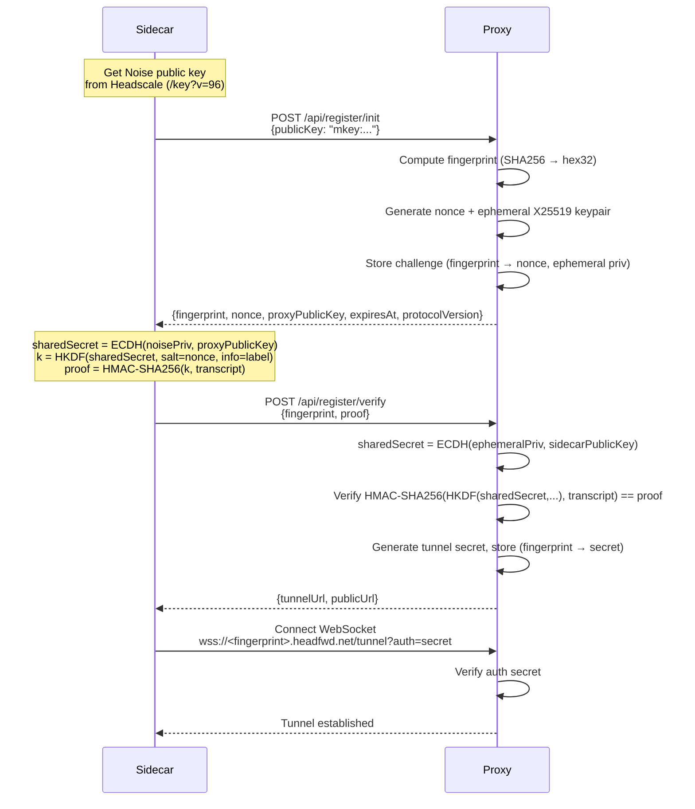

# HeadFwd Registration Architecture

## Overview

HeadFwd uses a two-phase challenge-response authentication protocol to secure registration and prevent unauthorized subdomain enumeration. This ensures only legitimate Headscale instances with valid Noise private keys can register tunnels.

The proof is an **X25519 ECDH + HKDF-SHA256 + HMAC-SHA256** exchange: the sidecar and proxy derive a shared secret from Headscale's Noise keypair and a proxy-generated ephemeral keypair, run it through HKDF to obtain a MAC key, then MAC the full registration transcript.

> **Protocol v2.** v1 used the raw ECDH output directly as an HMAC key over the bare nonce. That is fixed as of v2 — see [Protocol versions](#protocol-versions). There is no downgrade path: a v2 sidecar refuses a v1 relay. No new key material (no separate signing key) is introduced — the existing Noise X25519 key is reused. This is implemented in the proxy at `headfwd-proxy/` (Fly.io).

## Security Goals

1. **Proof of Ownership**: Only someone with access to Headscale's Noise private key can complete registration
2. **No Subdomain Enumeration**: Can't guess valid subdomains without the private key
3. **Time-Limited Challenges**: Nonces expire after 5 minutes to prevent replay attacks
4. **Replay Protection**: Each nonce is single-use
5. **Collision Resistance**: 128-bit fingerprints provide ~3.4×10³⁸ unique values

## Why ECDH + HMAC Instead of a Signature

Headscale's Noise key is a **Curve25519 (X25519)** key meant for ECDH key
exchange. It is **not** an Ed25519 signing key, so the sidecar cannot simply
sign the challenge nonce. That would need either a separate signing key or a
Curve25519→Ed25519 conversion.

Registration proves ownership with ECDH instead:

1. On `init`, the proxy generates a per-challenge **ephemeral X25519 keypair**
   and returns its public key (`proxyPublicKey`) with the nonce.
2. The sidecar computes `sharedSecret = X25519(noisePrivateKey, proxyPublicKey)`
   and derives the proof from it (see [Proof Scheme](#proof-scheme)).
3. On `verify`, the proxy computes the same secret as
   `X25519(ephemeralPrivateKey, sidecarPublicKey)` and checks the proof in
   constant time.

ECDH is symmetric, so only the holder of Headscale's Noise **private** key can
produce a matching proof. This proves ownership with no signing key, no key
conversion, no new secrets to manage and no changes to Headscale.

## Registration Flow



## Subdomain Fingerprinting

### Format
- **Encoding**: Hex (32 characters)
- **Bits**: 128 bits of security
- **Source**: First 128 bits of SHA256(Noise public key)
- **Example**: `b4ff5ae7bbf053c9bd58d16df68702e0.headfwd.net`

### Why Hex32?
1. **Universal Support**: Native hex encoding on all platforms (Go, JS, Swift, Kotlin)
2. **No Dependencies**: No external libraries needed
3. **DNS Compatible**: Works in subdomains without issues
4. **Collision Resistant**: ~3.4×10³⁸ possible values (2^128)
5. **Case Insensitive**: Works consistently across systems

### Security Properties
- **Collision Probability**: ~1 in 340 undecillion
- **Brute Force**: Would take billions of years with current computing
- **Enumeration**: Cannot guess valid subdomains without the private key
- **Never Trust the Proxy**: Clients must derive the fingerprint locally and validate any proxy-provided URLs or fingerprints

## Authentication Protocol

### Phase 1: Challenge Initialization

**Request:**
```bash
POST /api/register/init
Content-Type: application/json

{
  "publicKey": "mkey:fedcba9876543210fedcba9876543210fedcba9876543210fedcba9876543210"
}
```

**Response:**
```json
{
  "fingerprint": "b4ff5ae7bbf053c9bd58d16df68702e0",
  "nonce": "a1b2c3d4e5f6789...",
  "proxyPublicKey": "9f86d081884c7d65...",
  "expiresAt": 1738449600000,
  "protocolVersion": 2
}
```

**What Happens:**
1. Proxy rejects the request unless `publicKey` is `mkey:` followed by valid hex (`400`)
2. Proxy computes `fingerprint = SHA256(publicKey).substring(0, 32)`
3. If an unexpired challenge already exists for that fingerprint, proxy returns `409 Conflict`, so nobody can overwrite a registration in flight
4. Proxy generates a random 32-byte nonce
5. Proxy generates an ephemeral X25519 keypair for this challenge
6. Proxy stores `{publicKey, nonce, ephemeralPrivateKey}` with a 5-minute TTL
7. Returns the challenge (including its ephemeral **public** key) to the sidecar

### Phase 2: Proof Verification

**Request:**
```bash
POST /api/register/verify
Content-Type: application/json

{
  "fingerprint": "b4ff5ae7bbf053c9bd58d16df68702e0",
  "proof": "a1b2c3d4..."
}
```

**Response:**
```json
{
  "fingerprint": "b4ff5ae7bbf053c9bd58d16df68702e0",
  "tunnelUrl": "wss://b4ff5ae7bbf053c9bd58d16df68702e0.headfwd.net/tunnel?auth=SECRET",
  "publicUrl": "https://b4ff5ae7bbf053c9bd58d16df68702e0.headfwd.net"
}
```

**What Happens:**
1. Proxy retrieves the stored challenge for the fingerprint. If it is missing, expired, or has already had 5 attempts, the challenge is deleted and the proxy returns `400`
2. Proxy computes `sharedSecret = X25519(ephemeralPrivateKey, sidecarPublicKey)`
3. Proxy verifies `HMAC-SHA256(HKDF(sharedSecret, salt=nonce, info=label), transcript) == proof` (timing-safe compare)
4. If valid:
   - Generate a random 256-bit tunnel secret
   - Store `{publicKey, secret}` in memory (it lasts until the proxy restarts; the sidecar then re-registers automatically)
   - Delete challenge (single-use)
   - Return tunnel credentials
5. If invalid: Return `403 Forbidden`; the attempt still counts toward the limit of 5

Because ECDH is symmetric, the sidecar independently derives the same shared secret as `X25519(noisePrivateKey, proxyPublicKey)` — so only the holder of Headscale's Noise private key can produce a matching HMAC.

## Client Verification (Custom Clients)

This section documents an **optional online proof** for custom clients that want to treat the proxy as a dumb forwarder.
It uses the existing Headscale Noise X25519 key and does **not** introduce new key material.

### Step 0: Verify Fingerprint Matches `/key`

1. Client fetches the public key from the Headscale control server:
   - `GET /key?v=96` → `mkey:...`
2. Client computes `fingerprint = SHA256(publicKey).substring(0, 32)`
3. Client verifies the fingerprint matches the subdomain it connected to.

If the fingerprint does **not** match, the client must abort. This detects a proxy misroute or key substitution.

### Step 1 (Planned, not implemented): Online Attestation Using Noise Key

> **Not implemented.** No `/api/attest` endpoint exists in the sidecar today. This section is a design sketch.

Add a small endpoint (e.g. `/api/attest`) on the Headscale sidecar to prove possession of the Noise private key.

**Request:**
```json
{
  "clientPublicKey": "<hex X25519 public key>",
  "nonce": "<random 32 bytes, hex>"
}
```

**Server behavior** (the same construction as the registration proof, with its own domain-separation label):
1. Compute `sharedSecret = X25519(noisePrivateKey, clientPublicKey)`
2. Derive `k = HKDF-SHA256(sharedSecret, salt=nonce, info="headfwd attestation v1")`
3. Return `proof = HMAC-SHA256(k, transcript)`, where the transcript is a length-prefixed `label ‖ fingerprint ‖ noisePublicKey ‖ nonce ‖ clientPublicKey`

**Response:**
```json
{
  "proof": "<hex HMAC>"
}
```

**Client verification:**
1. Compute the same `sharedSecret = X25519(clientPrivateKey, noisePublicKey)`
2. Derive the same key and transcript, then compare against the response in constant time

This provides an **interactive proof of key possession** without adding new keys. Do not use the raw ECDH output as the HMAC key over the bare nonce. That was the v1 registration construction, and [Protocol versions](#protocol-versions) explains why it was replaced.

## Cryptographic Details

### Key Types
- **Noise Protocol**: Headscale's TS2021 control protocol uses Noise_IK with an X25519 static key
- **Public Key Format**: `mkey:` prefix + 64 hex characters (32 bytes)
- **Private Key**: 32-byte X25519 key, stored on disk as `privkey:` + 64 hex characters (`noise_private.key`)

### Proof Scheme
- **Key agreement**: X25519 ECDH between Headscale's Noise key and the proxy's per-challenge ephemeral key
- **Key derivation**: `HKDF-SHA256(sharedSecret, salt=nonce, info="headfwd registration proof v2")` → 32-byte MAC key
- **Proof**: `HMAC-SHA256(derivedKey, transcript)`, encoded as 64 hex characters
- **Transcript**: length-prefixed `label ‖ fingerprint ‖ publicKey ‖ nonce ‖ proxyPublicKey`
- **Verification**: recompute proxy-side and compare in constant time
- **No separate signing key**: the existing Noise X25519 keypair is reused; nothing new to manage or leak

### Protocol versions

| | v1 | v2 (current) |
|---|---|---|
| MAC key | raw ECDH output | `HKDF-SHA256(ECDH, salt=nonce, info=label)` |
| MAC message | nonce only | full length-prefixed transcript |
| Failed-proof handling | challenge survived until TTL | challenge burned after 5 attempts |
| Concurrent `/init` | silently overwrote the challenge | `409 Conflict` while one is in flight |
| Rate limiting | none | token bucket per source address |

**Why HKDF.** An ECDH output is a curve point, not a uniformly random key — it
has algebraic structure, and using it directly as keying material is exactly
what HKDF exists to prevent. It also matters here because the same long-term
Noise static key is reused across protocols, so a chosen-input MAC oracle on it
is a cross-protocol risk.

**Why the transcript.** v1's MAC covered only the nonce, so a valid proof said
nothing about *which* registration it authorised — not the fingerprint, not the
ephemeral key it was derived against. Fields are length-prefixed so that
`("ab","c")` and `("a","bc")` cannot serialise identically.

**No downgrade.** `/api/register/init` returns `protocolVersion`; a v2 sidecar
refuses anything else rather than falling back. Since init runs over plain HTTP,
a downgrade path would let an attacker who can tamper with the response force
the weaker proof.

**The fingerprint is unchanged.** It is `SHA-256(publicKeyString)[:32]`, computed
independently of any of this — so subdomains, pinned keys and issued invites all
survive the upgrade untouched.

### Storage
- In-memory maps in a single proxy process (challenges + registrations). If the proxy restarts, the sidecar simply re-registers automatically.

## Abuse Controls

Registration is unauthenticated by design: anyone can register a subdomain they can prove they hold the key for. Both endpoints do real crypto work (X25519 keygen on `init`, ECDH + HKDF on `verify`), so the proxy bounds them:

| Control | Value | Response |
|---|---|---|
| Rate limit (both `/api/register/init` and `/api/register/verify`) | Token bucket per client IP: 30 requests/min, burst of 10 | `429 Too Many Requests` |
| Request body size | 8 KiB max | `400` |
| Malformed public key on `init` | Must be `mkey:` + valid hex | `400` |
| Concurrent `init` for the same fingerprint | Refused while an unexpired challenge exists | `409 Conflict` |
| Failed proofs | Challenge deleted after 5 attempts | `400` (challenge gone) |
| Challenge lifetime | 5 minutes, single-use | `400` once expired |

The rate limiter is in-memory and per proxy instance, which avoids adding a shared-store dependency to a single static binary. The client IP is taken from `Fly-Client-IP`, then the first `X-Forwarded-For` entry, then the connection's remote address. Those headers can be spoofed if the proxy is exposed without a trusted front proxy; the worst case is an attacker evading their own rate limit. See `headfwd-proxy/ratelimit.go`.

## Sidecar Implementation

### Command-Line Usage

**Manual Tunnel URL:**
```bash
./headfwd-sidecar \
  --tunnel "wss://b4ff5ae7.headfwd.net/tunnel?auth=SECRET" \
  --headscale "http://localhost:8080"
```

**Auto-Registration:**
```bash
./headfwd-sidecar \
  --register \
  --proxy "https://headfwd.net" \
  --headscale "http://localhost:8080" \
  --noise-key "/var/lib/headscale/noise_private.key"
```

### Docker Compose

```yaml
headfwd-sidecar:
  build: ./headfwd-sidecar
  environment:
    - AUTO_REGISTER=true
    - PROXY_URL=https://headfwd.net
    - HEADSCALE_URL=http://headscale:8080
  volumes:
    - ./headscale/data:/keys:ro
```

### Key Auto-Detection
The sidecar automatically searches for Noise private key in:
1. Path specified by `--noise-key` flag
2. `/var/lib/headscale/noise_private.key`
3. `/keys/noise_private.key` (Docker mount)
4. `./headscale/data/noise_private.key` (local dev)
5. `../headscale/data/noise_private.key` (local dev, running from `headfwd-sidecar/`)

## Attack Resistance

### Subdomain Enumeration
- **Attack**: Guess valid subdomains by trying random fingerprints
- **Defense**: 
  - 128-bit fingerprints = 2^128 possibilities
  - Without the private key, cannot produce a valid proof
  - Challenge-response prevents unauthorized registration

### Replay Attacks
- **Attack**: Reuse a captured nonce/proof pair
- **Defense**:
  - Nonces are single-use (deleted after verification)
  - 5-minute expiration on challenges
  - Each proof is bound to its nonce and the proxy's per-challenge ephemeral key, so a new proof is required for each registration

### Man-in-the-Middle
- **Attack**: Intercept registration traffic
- **Defense**:
  - All production traffic over TLS (wss://, https://)
  - The ECDH+HMAC proof binds registration to the Noise private key
  - Clients additionally verify the Noise key against the fingerprint (see `ios-key-verification.md`)

### Brute Force
- **Attack**: Try to brute force private keys or forge a proof
- **Defense**:
  - X25519 provides ~128-bit security; deriving the shared secret without the Noise private key is infeasible
  - HMAC-SHA256 over an HKDF-derived key makes proof forgery infeasible
  - Token-bucket rate limiting per source address on both registration endpoints
  - A challenge is destroyed after 5 failed proofs, so one nonce cannot be
    attacked for its full TTL

## Comparison with Alternatives

| Approach | Security | Complexity | Enumeration Risk |
|----------|----------|------------|------------------|
| **Challenge-Response (Current)** | High | Medium | None |
| Shared Secret | Medium | Low | Medium |
| Rate Limiting Only | Low | Low | High |
| OAuth/JWT | High | High | None |

## Future Enhancements

Rate limiting is already implemented (see [Abuse Controls](#abuse-controls)). Still open:

1. **Key Rotation**: Support for rotating tunnel secrets
2. **Revocation**: API endpoint to revoke tunnel access
3. **Monitoring**: Track registration attempts and failed verifications
4. **Multi-Key**: Support for registering multiple Headscale instances with one account
5. **Online Attestation**: The `/api/attest` endpoint sketched in [Client Verification](#client-verification-custom-clients)

## References

- [Noise Protocol Framework](http://www.noiseprotocol.org/)
- [X25519 (RFC 7748)](https://datatracker.ietf.org/doc/html/rfc7748)
- [HMAC (RFC 2104)](https://datatracker.ietf.org/doc/html/rfc2104)
- [Headscale Documentation](https://headscale.net/)
